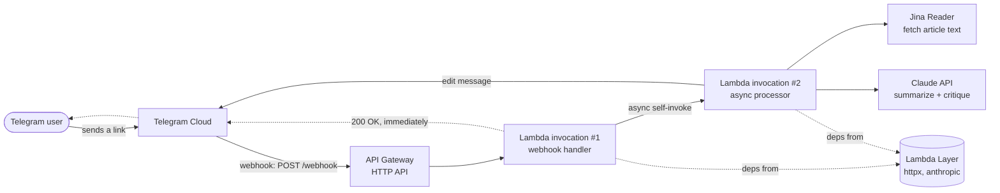
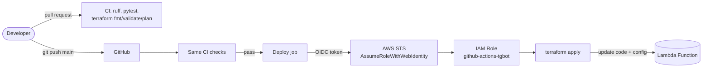

# TL;DR Bot — Telegram Article Summarizer on AWS Lambda


A Telegram bot that turns any article link into a critical, fact-checked summary using
Claude — running serverless on AWS Lambda, deployed automatically from GitHub via
Terraform and OIDC (no long-lived AWS credentials anywhere).

Send it a URL, get back the gist, the key claims, and a critical read of what's
questionable or unsupported in the article — not just a friendly recap.

## Architecture



**Why a webhook instead of polling?** Lambda runs one invocation per request and then
exits — it can't run an infinite `getUpdates` polling loop. So Telegram is configured to
push updates to an HTTPS endpoint (API Gateway → Lambda) instead.

**Why does Lambda call itself?** Telegram expects a webhook response within a few
seconds, or it assumes delivery failed and retries. Summarizing an article (fetch +
Claude call) can take 30–40 seconds. So the first invocation acknowledges immediately
(`200 OK`) and asynchronously invokes itself a second time to do the actual work without
a deadline, editing the Telegram message once it's done.

**Why a Lambda Layer?** `httpx` and `anthropic` aren't part of the Lambda runtime.
Bundling them into every deploy's zip would mean shipping megabytes of unchanged
third-party code on every push. Instead they're packaged once as a Lambda Layer, so each
deploy only ships the few KB of actual bot code that changed.

## CI/CD pipeline



- **Nothing reaches production unchecked.** Every pull request runs lint
  (`ruff`), offline unit tests (`pytest`, every external API mocked) and
  `terraform fmt`/`validate`/`plan`; the deploy workflow calls the very same
  checks before `apply`, so a direct push to `main` can't skip them.
- **One apply at a time.** The deploy job is serialized (`concurrency`) and the
  Terraform state is locked with S3-native locking (`use_lockfile`), so two quick
  pushes can't race each other into a corrupted state.
- **Pinned supply chain.** Every third-party action is pinned to a commit SHA
  (a moved tag can't swap the code that runs with AWS credentials), and
  Dependabot proposes the bumps as reviewable PRs.
- **No AWS keys in GitHub.** The workflow authenticates via OIDC — GitHub issues a
  short-lived signed token, AWS exchanges it for temporary credentials scoped to one IAM
  role. Nothing to leak, nothing to rotate.
- **Terraform manages only what should change on every push**: the Lambda function's
  code and config. API Gateway, the execution role, and the dependency Layer are
  referenced read-only — they already worked, and giving the deploy pipeline broader
  ownership (and broader IAM permissions) would add risk without adding value.
- **Secrets stay where they are.** Bot/API tokens are set directly as Lambda environment
  variables; Terraform is explicitly told to ignore that field
  (`lifecycle.ignore_changes`), so a deploy never overwrites them.
- **The webhook itself is authenticated.** The API Gateway URL isn't secret, but the
  Lambda rejects (`401`) any webhook request that doesn't carry a matching
  `X-Telegram-Bot-Api-Secret-Token` header — so finding the URL alone isn't enough to
  trigger the bot (and run up the Anthropic bill) on someone else's behalf. Both
  checks fail closed: an unset secret rejects every request instead of skipping
  the check.
- **The bot is private.** A valid webhook only proves the request came from
  Telegram, not who sent the message — so only chats listed in `ALLOWED_CHAT_IDS`
  get a summary; everyone else gets a one-line refusal before any paid API call.
- **A slow request can't double-bill.** The async invocation passes its real
  remaining Lambda time down to the Claude call, so a slow response surfaces as a
  normal error message instead of a Lambda timeout — and async retries are
  disabled, so a failure is never silently re-run from scratch.

## Repository layout

```
src/
  lambda_function.py   # the bot — this is what actually runs in production
  local_dev.py          # local long-polling runner for development, reuses the same code
infra/                  # Terraform: manages Lambda function code/config only
.github/workflows/      # ci.yml: PR checks; deploy.yml: same checks, then OIDC + terraform apply
tests/                  # offline unit tests (pytest), all external calls mocked
requirements.txt         # full dependency set for local development
requirements-dev.txt     # requirements.txt + pinned pytest/ruff
requirements-lambda.txt  # documents what's actually bundled in the Lambda Layer
scripts/set_webhook.py   # one-off script to (re)register the Telegram webhook
```

## Local development

```bash
python -m venv .venv
.venv\Scripts\activate
pip install -r requirements.txt
cp .env.example .env    # fill in TELEGRAM_BOT_TOKEN and ANTHROPIC_API_KEY
cd src
python local_dev.py     # runs via polling — production Lambda is untouched
```

Edit `src/lambda_function.py` — same file, same functions, run locally or in Lambda.

> **Use a separate bot for local dev.** `local_dev.py` polls via `getUpdates`,
> but Telegram doesn't allow polling and a webhook on the same bot
> simultaneously — pointing it at the production bot's token fails with a
> `409 Conflict`. Create a second bot via `@BotFather` (free, instant) for
> development.

## Deploying a change

```bash
pip install -r requirements-dev.txt
ruff check . && pytest          # the same checks CI runs
git checkout -b my-change
git commit -am "Describe what changed and why"
git push -u origin my-change    # open a PR: CI checks + terraform plan
```

Merging to `main` re-runs the checks, then builds the package, authenticates to
AWS, and runs `terraform apply` — the Lambda function is updated within a few minutes. Watch it run
under the [Actions tab](https://github.com/daniel-syachin/tldr_sum_bot/actions).

> Adding a *new* third-party import needs one extra step: dependencies live in a Lambda
> Layer, not the deploy zip. See the rebuild command in `requirements-lambda.txt`.

## What this project demonstrates

Built as a hands-on project to move from "a script that works" to "a system with a
deploy pipeline" — the kind of work an SRE role actually involves:

- **Infrastructure as Code** — Terraform managing exactly the resources it should,
  deliberately *not* taking over infrastructure that already worked, to keep blast
  radius and required IAM permissions minimal.
- **Keyless CI/CD** — OIDC federation between GitHub Actions and AWS IAM, including
  debugging a real trust-policy mismatch (GitHub's immutable subject claims) rather than
  just widening permissions until it worked.
- **Least-privilege IAM** — scoping the CI role's policy down to the specific
  resources and actions it needs, and fixing a policy that referenced a nonexistent
  resource ARN.
- **Observability and incident response** — using CloudWatch Logs to diagnose a
  silent failure (a bot stuck mid-response) down to a root cause (an unchecked API
  response), rather than guessing.
- **Secret hygiene** — catching and fixing a credential leaking into logs via a
  third-party library's default logging behavior, then rotating the exposed credential.
- **Defense in depth** — authenticating the webhook itself (a shared-secret header
  check) instead of relying on the endpoint URL being hard to guess.
- **Serverless architecture trade-offs** — webhook vs. polling, and an async
  self-invoke pattern to work within a webhook's response-time budget.
- **Resilience to upstream API changes** — a model bump (`claude-sonnet-4-6` →
  `claude-sonnet-5`) broke every request because the code assumed a fixed
  response shape (`content[0]` is always the answer). Diagnosed from
  CloudWatch, fixed by selecting the response block by type instead of
  position — a small example of not trusting a dependency's output shape to
  stay constant across versions.

## Changelog

See [CHANGELOG.md](CHANGELOG.md) for what's changed since this pipeline was set up, and
keep adding to it as you make future changes.

## License

[MIT](LICENSE)

## Acknowledgments

This project's CI/CD pipeline, Terraform setup, and production debugging were built
collaboratively with [Claude](https://www.anthropic.com/claude) (Anthropic) acting as a
pair-programming assistant and mentor: designing the pipeline, live-debugging real AWS
and GitHub OIDC issues, and explaining the reasoning behind each decision along the way.
Every change to AWS and GitHub configuration was reviewed and explicitly approved before
being applied.
